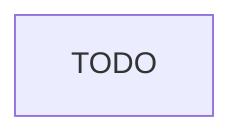

# Zero-Knowledge Proofs

HollowDB utilizes [zero-knowledge proofs](https://en.wikipedia.org/wiki/Zero-knowledge_proof) within to provide a zero-knowledge authentication scheme. So, what are they?

Zero-Knowledge Proofs (ZKPs) is a method that allows one to prove that a given statement is true, without revealing any other information other than the statement itself! We usually refer to the proving party as the **Prover**, and the verifying party as the **Verifier**.

Example statements are:

- "I know the solution to some puzzle", which the prover must prove without showing the solution itself.
- "I know some $x$ such that $f(x) = 0$", which the prover must prove without revealing what $x$ is.
- "I know the private key that corresponds to some public key", which the prover must prove without revealing the private key.

## Anatomy of a ZKP

Looking at a zero-knowledge protocol as a very high-level diagram, we have the following flow:



A prover has some secret inputs (a witness) that they would like to keep secret, and they might also have some public inputs. They feed these into an algebraic circuit, which is really like an electric circuit but instead of electricity, it works on non-negative integers (i.e. elements of a finite field) and you can only do addition and multiplication.

As a result, they get the output of this computation, along with a proof. Note that the output is not really necessary too, you could also have a proof without giving any outputs, which is a way of saying "hey I have ran this circuit that you have told me to, and I got no errors". An example of this is a Sudoku solution prover circuit, where a public puzzle is provided and the user feeds their secret solution to the circuit. The circuit then makes sure the solution is valid, and basically compiles without failures if indeed it is valid.

## Hashing

Before we move on, we also need to describe what "hashing" is, which is used extensively in the zero-knowledge proofs of HollowDB. Hashing is simply a function that takes some arbitrary input, and outputs a fixed-length output. We refer to the input as preimage, and the output as digest or hash.

We expect the following properties from a hash function $H$:

- Given some hash $y$ such that $y=H(x)$ it should be really hard to find what $x$ is. This is called **preimage resistance**.
- Given an input $x_1$, it should be really hard to find another input $x_2$ such that $H(x_1) = H(x_2)$. This is called **second-preimage resistance**.
- Given two inputs $x_1$ and $x_2$, it should be really unlikely that $H(x_1) = H(x_2)$. This is called **collision resistance**.
- The output of the hash function should appear "random", i.e. it should be distributed as evenly as possible. In doing so, even just a slight change in the input should completely change the output. This is commonly referred to as **avalanche effect**.

Note that the input size is arbitrary but the output size is fixed, is that a problem for the properties above? Well it certainly could be; however, in practice the output length of these hash functions are pretty big, such as 256-bits or 512-bits. There are $2^{256}$ possible outputs for a 256-bit output, which is a lot more than the number of atoms in the world.

So how does hashing relate to zero-knowledge proofs? Imagine that you wrote the entire hash function as an arithmetic circuit, and you provide the preimage as the secret input. The output will be the digest, and you will have a proof that you know what preimage resulted in this digest. In other words, you can prove the statement "I know some $x$ such that $y = H(x)$ for a publicly known $y$" by simply writing the entire hash function $H$ as a circuit.

There are many different hash functions with varying security levels and output lengths, and the most important thing to note is that not all of them are circuit-friendly. What this means is that, some hash functions (e.g. **SHA256**) are really costly to implement with a circuit. A higher cost means more gates and more constraints, thus requiring a longer proving time and circuit-setup time. Thankfully, there are friendlier hash functions, a well-known one being the **Poseidon** hash.

## Hollow Authorization

HollowDB is a key-value database, and we want users to have control over their data, i.e. only they should be able to change the value at their respective key. This is achieved by the following:

- User knows some secret $s$.
- They hash this secret to obtain a key $k$ as in $k \gets H(s)$.

The user will PUT to this key, and only they will be able to UPDATE or REMOVE this key! This is done by requiring a ZKP that whoever wants to update some key knows the preimage $s$ of that key. Lets rewrite the diagram above to show what is happening here:


Lets examine this diagram:

- The client wants to update some `key` that they know the preimage of, with some new `value`.
- Client generates a zero-knowledge proof to prove that they indeed know the preimage. They send the proof, along with the `key` and the `value` to the smart contract, which is HollowDB.
- Within the smart contract, the proof is verified and if it is valid, the key is updated. If proof is invalid, transaction is reverted.

The important point here is that Smart Contract does not see `preimage` at all!

### Security Issues

If you think about this method in practice, it has two security issues:

- **Replay Attack**: If an adversary gets hold of your proof, they can use that proof to claim that they know the preimage to your key even though if they dont! This is like someone stealing your credit card, and then doing contactless payments that do not ask for password on low amounts. We would like to prevent this.
- **Middle-man Attack**: Another issue is that the proof contains nothing related to the value to be written. If an adversary steals your proof before it gets to the smart contract (perhaps a middle-man between you and the smart contract) then they can change the value to be written by simply using your proof.

The solution to these problems are simple: we need to put some constraints within our proof related to the current value and the new value to be written.

- if the proof is only valid for some current value at that key, it will be invalid when that value changes, thus preventing the replay attack.
- if the proof is only valid for the new value that I am going to write to that key, it will be invalid for any other value, thus preventing the middle-man attack.

However, we have said that arithmetic circuits operate on integers, but our values can be anything; so how do we represent our values as integers? The answer is: hashing! The client will hash both the current value and the new value separately, obtaining two hashes. So now lets see the final diagram that shows how how both attacks are mitigated:


> [!NOTE]
>
> You must ensure that the resulting hash is within the limit of the finite-field used in the circuit. For example, [Circom](https://docs.circom.io/) supports the [Baby JubJub](https://eips.ethereum.org/EIPS/eip-2494) elliptic curve for its arithmetic circuits to be used in Ethereum, and the order of the finite field is:
>
> ```
> 21888242871839275222246405745257275088548364400416034343698204186575808495617
> ```
>
> This means that any value in your circuit must be less than this number. If you have a larger number, they will wrap back around as in modular arithmetic. You can use different curves and thus different orders, but this is important to keep in mind.
>
> The number above is around 254 bits, and if we were to input a 256-bit number, things may work without the way we intend them to. This is especially important if we are trying to use a hash as an input. One could use hash functions with smaller output size, such as [ripemd160](https://en.bitcoin.it/wiki/RIPEMD-160), which has a 160-bit output and is definitely within the limits of our arithmetic circuit which is much larger. There are other methods to "fit" a hash within a field element too.
